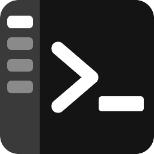
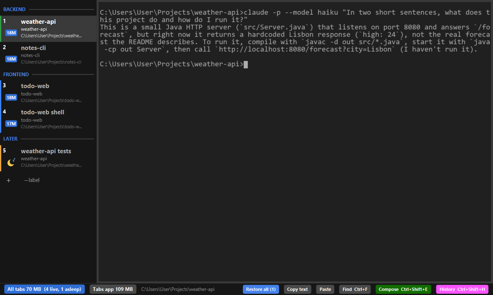
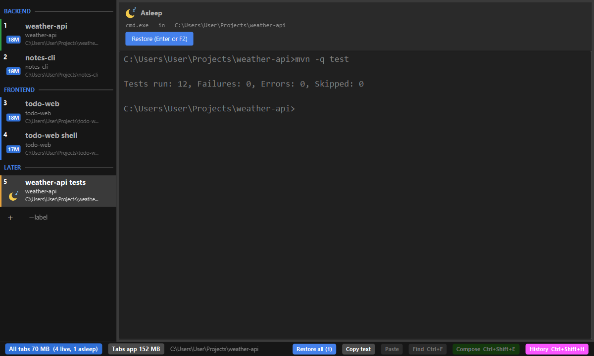
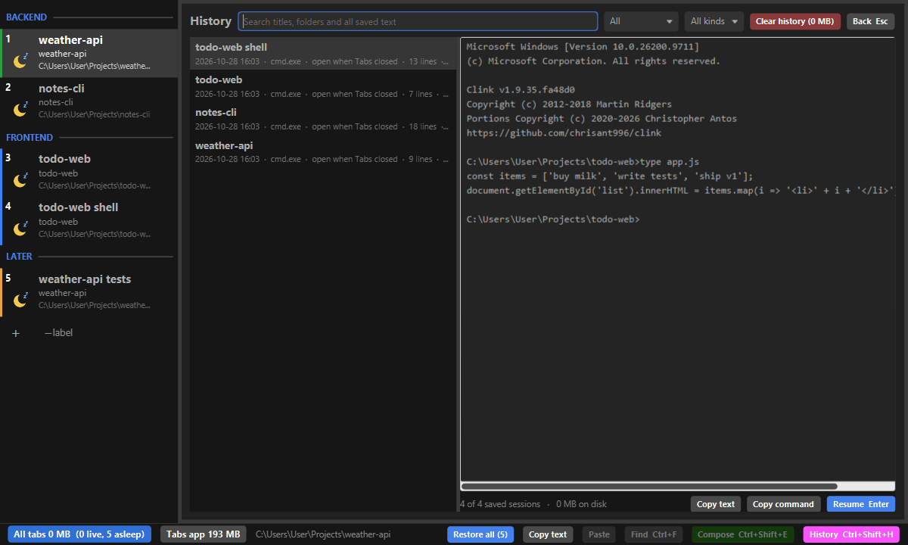
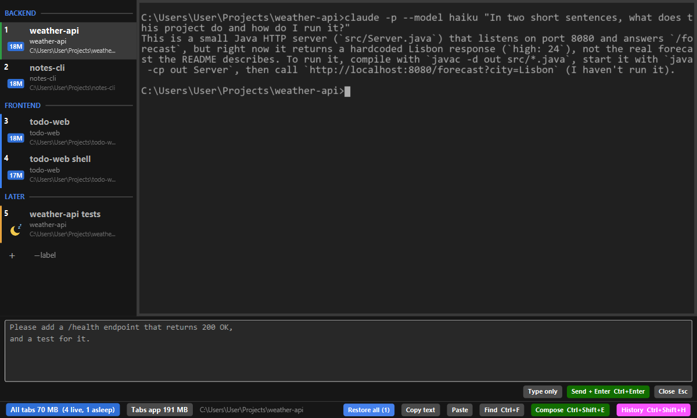

<p align="center"></p>

# Tabs

Full name **FxTerminalTabs**; we simply call it **Tabs**. The project and its files are named `fxterm-tabs` (organisation [fxterm](https://fxterm.github.io)).

A terminal for Windows and macOS with vertical tabs, made for long sessions with AI coding agents such as Claude Code. Tabs sleep and wake like a browser's, every session can be found again in History, and several windows share one process. An idle window uses a few tens of MB.

Status: 0.1, early releases. Windows is the main platform; macOS (Apple silicon and Intel) is new in 0.1.4 and tested far less.



## What it does, with examples

### Vertical tabs, grouped

Each tab shows three lines: its title, its folder's name, and the full path. A number in the corner is the key that reaches it (Ctrl+1 or Alt+1 for the first). In the picture above, **Backend**, **Frontend** and **Later** are separators: labels that group the tabs under them. Add one with the "⎯ label" button under the list, or with "Insert separator above" in a tab's menu. Separators are never selected and are skipped by Ctrl+Tab and the number keys.

Click a label to fold its group. Each label also has a **Zz** button at its right end for the group's sleeping tabs: it shows how many there are ("Zz 3"); click it and the sleeping tabs are hidden, leaving the live ones, and the button turns solid and counts what is hidden ("Zz 3 hidden"), so nothing is ever silently gone. Click again to show them. Hidden tabs keep their places, so the order of your list does not change; the tab you are looking at always stays in view, and a tab you wake appears at once. Ctrl+Shift+Z does the same for the group of the shown tab, and the label's menu has it too. The choice is saved with the label.

Give a tab a colour from its menu (right-click, Colour) and the colour shows as a strip at its left edge. The active tab is a lighter row with white text. If you prefer the whole row and the frame round the terminal in the tab's colour, start Tabs with `--tab-fill full`.

Drag a tab to reorder it (or press Ctrl+Shift+PgUp / PgDn). A new tab opens just after the current one.

### Opening a tab inside a group

A launch from the command line can say where its tab goes: `fxterm-tabs run --group "<label>" <command...>`, `fxterm-tabs open --group "<label>" [dir]` and `fxterm-tabs ctl new group=<label>`. The new tab goes at the end of that group, so tabs launched one after another stay in launch order. A group that does not exist is made, as a label at the end of the window. Write `--group` right after `run` or `open` and before the command, so a command that itself starts with `--` still works.

Without `--group`, the tab goes into the group of the tab the launch came from. Every tab's programs have `FXTERM_TABS_TAB=<tab id>` in their environment, and every process below the tab inherits it (claude, its shell tool, proj, cmd, the launcher), so this works however many levels down, even when a process in between has already ended. A launch from a tab in no group, or with an id that no tab has any more (Tabs was restarted), opens at the end of the window as before.

The window is the one of the starting tab when it is known; with `--group`, the window that already has a label of that name (the starting tab's window first). A folded group opens for the new tab, and a new tab is never hidden by a group's Zz.

`fxterm-tabs ctl whoami`, run inside a tab, answers that tab's id, window index, group (null when none) and folder.

### Tabs that sleep and wake



When Tabs closes it saves every tab. When it starts again, every tab comes back **asleep**: no process runs, and the tab shows the text it had, so you can read or copy it. Press Enter or F2 (or click Restore) to wake it.

- A shell wakes in its last folder.
- A Claude Code tab wakes as the same conversation with the same flags (`claude ... --resume <id>`).
- If a shell had been running Claude Code before Tabs closed, F3 resumes that last conversation instead.
- The sun button in the row above the tab list ("Restore all") wakes every sleeping tab in the window.

A sleeping tab is dulled in the list and carries a grey moon; hover the moon and it turns into a yellow sun, and one click wakes the tab. To put a tab to sleep yourself, hover its RAM figure and click Zz, or choose Hibernate in its menu. When memory runs short, hidden Claude tabs that have been idle are put to sleep for you.

Closing a tab (its x, Ctrl+Shift+W, or its menu) closes a bare shell at once. When Claude Code or any other program is running in it, Tabs asks first: **Close** (F2), **Hibernate** (F3) or cancel (Esc).

### RAM at a glance

Each live tab shows the RAM of its shell and everything it runs: blue under 100 MB, yellow from 100, orange from 200, and the heaviest tab red. The footer shows all tabs together ("All tabs 70 MB (4 live, 1 asleep)") and Tabs' own share.

### Several windows, one process

Drag a tab out of the window and it opens in a new window, with its program still running. Drop it on another window's list to move it there, or use "Move to window" in its menu. Ctrl+Shift+N opens a new window. A window left without tabs closes. Every window, with its place on the screen and its tabs, comes back after a restart.

### Window names and colours

Each window has its own colour, never one that another open window wears, and can be given a name. The colour fills the window's title bar and border on Windows 11 and the terminal icon on the taskbar, so windows tell apart at a glance. The row above the tab list has flat icon buttons, with colour when the mouse is over one: History, the window's colour, its name, Restore all (the sun) and Settings (the gear). Name and colour are kept across restarts. "No colour" in the colour menu gives the plain look (the terminal's own black title bar, the untinted icon), and "Default name (Window N)" in the gear menu clears the name; `ctl window-colour colour=none` and `ctl window-name name=` do the same. The gear menu's "Default folder for new tabs…" sets where a new tab opens (kept in `folder.json`, one setting for every window; a folder given with `open <dir>`, `ctl new dir=` or `--cwd` still wins, and empty means the home folder).

### The tab switcher

Ctrl+Tab opens a popup that goes to a tab in any window. The list on the left holds every awake tab, under its group, under its window, and then the same again for the hibernated tabs; the right side shows what the highlighted tab shows now, or its saved text when it sleeps. Type to filter: a tab's number, part of its name or folder, a window's or group's name, several words at once. Up and Down move, Enter goes there, Backspace takes back what was typed, Esc closes.

### A tab that asks for you

A program in a tab that is blocked on you (Claude Code, say) runs `fxterm-tabs ctl attention on`; Tabs finds that tab by itself. Its row turns amber with a softly glowing bell, Tabs plays one quiet sound, and a small popup asks whether to switch to that tab: Yes (F2), No (Esc), and with no answer in 20 seconds Tabs switches there by itself. Keys are ignored for the first moments, so what you were typing cannot answer it. `fxterm-tabs ctl attention off` takes the bell away, and so does typing in that tab. A title that starts with a bell, a warning sign, a siren or an exclamation mark does the same, and keeps the mark in the window title and tooltip. Only the animated marks programs cycle through (claude's stars, braille dots, the spinning bar) are replaced by Tabs' own activity ring. Only the bell glows; no row moves or changes size, so the tab list never shakes.

### History



Every tab that closes or goes to sleep is kept, with its text, and so is every tab that was open when Tabs closed. Ctrl+Shift+H opens History. Search finds words in titles, folders and the saved text. Filter by date and kind, preview the text, copy it, copy the command that resumes it, or press Enter to resume it in a new tab.

### Compose box



Ctrl+Shift+E opens an editor under the terminal for writing what a terminal makes awkward, such as a request of several lines for an AI agent. It takes the terminal's own colours, and has an editor's tools (bold, italic, headings, lists) and a writer bar for dictation (F3) and spelling. Ctrl+Enter sends it to the tab as one paste followed by Enter; "Type only" sends it without Enter.

### Select, read aloud, quote

Select text in the terminal and a small bar appears beside it: **Copy**, **Read aloud**, **Quote & reply** (into the compose box) and **Quote in notepadfx**. Read aloud speaks the selection and lights each word in the terminal as it is said, scrolling to keep it in sight; while it reads, the footer shows Pause, Stop, speed and Voice. Claude's own markers and the box-drawing characters are not read.

### Font size

Ctrl+= makes the text bigger, Ctrl+- smaller, and Ctrl+0 goes back to the default. Ctrl+mouse wheel and pinching on a touchpad or touch screen do the same. The size applies to every tab in every window and is remembered.

### Also

- The right mouse button pastes (Ctrl+right-click keeps the menu).
- The footer tells whether a newer Tabs is released: it checks when Tabs starts and every 24 hours, and the small button beside the status checks now. Nothing is downloaded by itself. When one is out, click "Update ... available": Tabs asks, downloads it (checked against its SHA-256), replaces itself, and offers to restart, with every tab saved and waking where it was. The same on a Mac. From a terminal: `fxterm-tabs -Xjr:update` (a copy not started through the release exe opens the release page instead).
- The footer shows the tab's folder; click it to copy. Copy text copies the whole tab, Find (Ctrl+F) searches it.
- A tab's menu: copy folder path, copy command (the line that brings the tab back in any cmd window), rename, colour, duplicate, hibernate or restore, move to window, insert separator above, close, close tabs above / below / others.
- Colours and font size are read from an existing Tabby configuration, so moving over looks the same.
- Tabby-compatible command line: `fxterm-tabs open <dir>` opens a shell there, `fxterm-tabs run <command...>` opens a tab running a command. A second launch adds a tab to the running window. `--group "<label>"` puts the new tab in a group (next section).

### On a Mac

Install in Terminal (curl sets no download mark, so macOS does not block the file; a browser download would be blocked until you choose Open Anyway in System Settings, Privacy & Security):

```
curl -fLo /tmp/fxterm-tabs https://github.com/fxterm/tabs/releases/latest/download/fxterm-tabs-macos-$(uname -m) && chmod +x /tmp/fxterm-tabs && /tmp/fxterm-tabs -Xjr:install
```

That puts `Tabs.app` in `~/Applications` and a command `fxterm-tabs` in `~/.local/bin`; no administrator rights. It needs Java 25 (jr offers to download one if none is found). Update later by clicking the footer's "Update ... available", or with `fxterm-tabs -Xjr:update`.

What differs from Windows:

- The Command key does what Ctrl does on Windows: Cmd+T new tab, Cmd+N new window, Cmd+W close, Cmd+1..9 go to a tab, Cmd+= / Cmd+- / Cmd+0 font size, Cmd+Shift+E compose, Cmd+Shift+H history, Cmd+C / Cmd+V copy and paste. Ctrl+Tab and Ctrl+Shift+Tab still open the tab switcher, and every Ctrl key goes to the program in the tab.
- New tabs run your login shell (`$SHELL -l`, zsh by default). A tab that ran Claude Code wakes as `claude ... --resume <id>` inside a login shell, and drops back to a shell when claude ends.
- The look is VS Code's terminal in its Dark Modern theme, in Menlo. `--theme tabby` uses an existing Tabby configuration instead (`~/Library/Application Support/tabby/config.yaml`).
- Not on a Mac yet: dragging a tab out of the window into a new window, clickable file paths (web links work), and dictation (it needs speech keys; the build now writes the microphone permission text, since jr-maven-plugin 1.5.0, but it has not been tried on a Mac yet). Read aloud works with the Deepgram voices when `~/speechfx/keys/deepgram_keys.xml` holds a key; the free system voices are not connected. Everything else in this README works on a Mac.

## Keys

- Ctrl+Shift+T new tab, Ctrl+Shift+N new window, Ctrl+Shift+W close tab
- Ctrl+Tab opens the tab switcher (Ctrl+Shift+Tab opens it one up): type a number or part of a name, Up/Down, Enter; Ctrl+1..9 or Alt+1..9 go straight to a tab
- Ctrl+Shift+PgUp / PgDn move the tab up / down
- Ctrl+Shift+E compose, Ctrl+Shift+H history, Ctrl+F find
- Ctrl+= / Ctrl+- / Ctrl+0 font size
- On a sleeping tab: Enter or F2 wake, F3 resume its last Claude conversation
- F11 full screen

Everything else goes to the program in the tab.

## Install

Download `fxterm-tabs.exe` from the [latest release](https://github.com/fxterm/tabs/releases/latest) and run it. It needs Java 25 (the exe finds an installed JDK 25 or later). On first run it downloads `fxterm-tabs.jar` from the same release and checks it against the SHA-256 built into the exe. `fxterm-tabs.exe -Xjr:update` moves to a newer release.

Settings and saved state live in `%USERPROFILE%\fxterm\tabs`: open tabs, window places, font size, history and the log.

## Options

- `--tab-fill strip|full` a tab's colour as the strip at its edge (the default), or filling the row and the frame
- `--font N`, `--family NAME` the terminal font (Consolas on Windows, Menlo on a Mac)
- `--theme tabby|vscode` colours from an existing Tabby configuration (the default on Windows), or VS Code's Dark Modern terminal (the default on a Mac)
- `--shell CMD` the shell for new tabs (cmd.exe on Windows, your login shell on a Mac)
- `--restore false` start with a fresh tab instead of the saved ones

## Build

JDK 25 and Maven:

```
mvn verify
app\target\jr\fxterm-tabs.exe
```

`mvn -Djr.source=url verify` builds the release files in `app\target\jr\release`.

## Credits and licences

Tabs is Apache-2.0 (see LICENSE). The terminal widget is a modified copy of [JediTermFX](https://github.com/techsenger/jeditermfx) 1.1.0 (module `jeditermfx-ui`), itself a JavaFX port of JetBrains' JediTerm, dual-licensed Apache-2.0 / LGPL-3.0; the licence texts are in that module. Process handling uses [pty4j](https://github.com/JetBrains/pty4j); the exe is made with [jr](https://github.com/jarrunner/jr).
