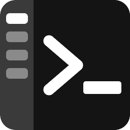
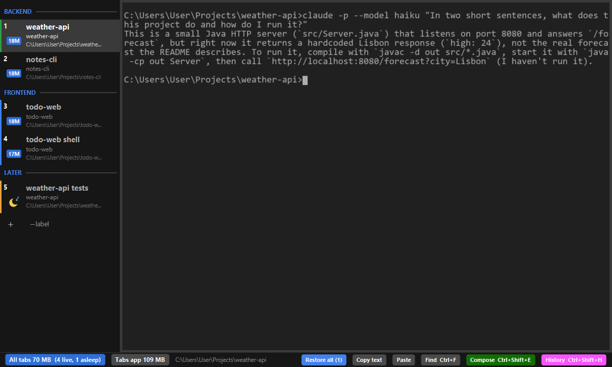
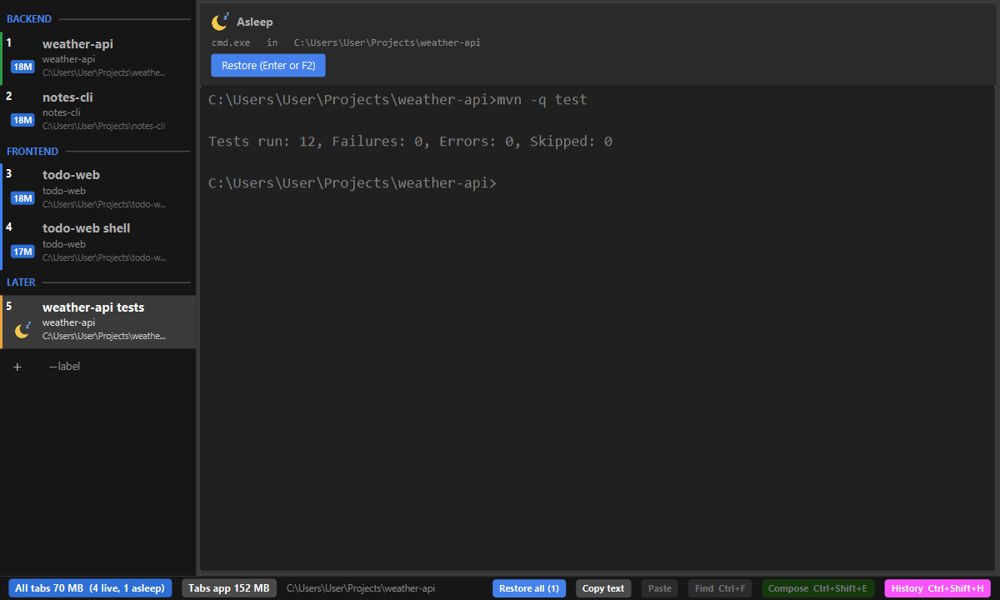
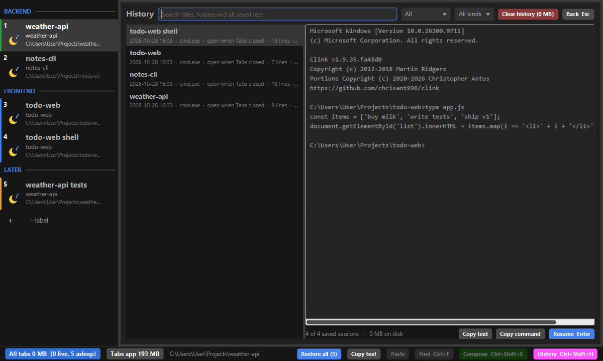
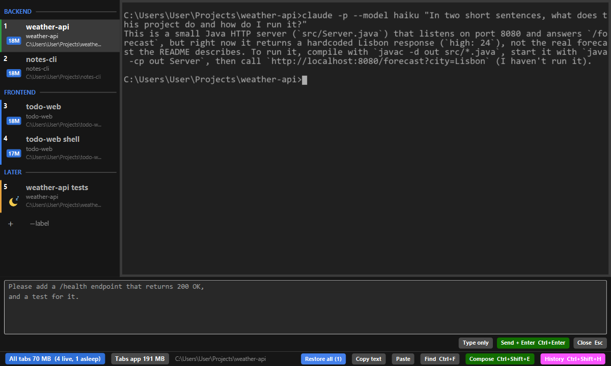

<p align="center"></p>

# Tabs

Full name **FxTerminalTabs**; we simply call it **Tabs**. The project and its files are named `fxterm-tabs` (organisation [fxterm](https://fxterm.github.io)).

A Windows terminal with vertical tabs, made for long sessions with AI coding agents such as Claude Code. Tabs sleep and wake like a browser's, every session can be found again in History, and several windows share one process. An idle window uses a few tens of MB.

Status: 0.1, early releases. Windows only.



## What it does, with examples

### Vertical tabs, grouped

Each tab shows three lines: its title, its folder's name, and the full path. A number in the corner is the key that reaches it (Ctrl+1 or Alt+1 for the first). In the picture above, **Backend**, **Frontend** and **Later** are separators: labels that group the tabs under them. Add one with the "⎯ label" button under the list, or with "Insert separator above" in a tab's menu. Separators are never selected and are skipped by Ctrl+Tab and the number keys.

Give a tab a colour from its menu (right-click, Colour) and the colour shows as a strip at its left edge. The active tab is a lighter row with white text. If you prefer the whole row and the frame round the terminal in the tab's colour, start Tabs with `--tab-fill full`.

Drag a tab to reorder it (or press Ctrl+Shift+PgUp / PgDn). A new tab opens just after the current one.

### Tabs that sleep and wake



When Tabs closes it saves every tab. When it starts again, every tab comes back **asleep**: no process runs, and the tab shows the text it had, so you can read or copy it. Press Enter or F2 (or click Restore) to wake it.

- A shell wakes in its last folder.
- A Claude Code tab wakes as the same conversation with the same flags (`claude ... --resume <id>`).
- If a shell had been running Claude Code before Tabs closed, F3 resumes that last conversation instead.
- "Restore all" in the footer wakes every tab in the window.

To put a tab to sleep yourself, hover its RAM figure and click Zz, or choose Hibernate in its menu. When memory runs short, hidden Claude tabs that have been idle are put to sleep for you.

### RAM at a glance

Each live tab shows the RAM of its shell and everything it runs: blue under 100 MB, yellow from 100, orange from 200, and the heaviest tab red. The footer shows all tabs together ("All tabs 70 MB (4 live, 1 asleep)") and Tabs' own share.

### Several windows, one process

Drag a tab out of the window and it opens in a new window, with its program still running. Drop it on another window's list to move it there, or use "Move to window" in its menu. Ctrl+Shift+N opens a new window. A window left without tabs closes. Every window, with its place on the screen and its tabs, comes back after a restart.

### History



Every tab that closes or goes to sleep is kept, with its text, and so is every tab that was open when Tabs closed. Ctrl+Shift+H opens History. Search finds words in titles, folders and the saved text. Filter by date and kind, preview the text, copy it, copy the command that resumes it, or press Enter to resume it in a new tab.

### Compose box



Ctrl+Shift+E opens an editor under the terminal for writing what a terminal makes awkward, such as a request of several lines for an AI agent. Ctrl+Enter sends it to the tab as one paste followed by Enter; "Type only" sends it without Enter.

### Font size

Ctrl+= makes the text bigger, Ctrl+- smaller, and Ctrl+0 goes back to the default. Ctrl+mouse wheel and pinching on a touchpad or touch screen do the same. The size applies to every tab in every window and is remembered.

### Also

- The right mouse button copies the selection, or pastes when nothing is selected.
- The footer shows the tab's folder; click it to copy. Copy text copies the whole tab, Find (Ctrl+F) searches it.
- A tab's menu: copy folder path, copy command (the line that brings the tab back in any cmd window), rename, colour, duplicate, hibernate or restore, move to window, insert separator above, close, close tabs above / below / others.
- Colours and font size are read from an existing Tabby configuration, so moving over looks the same.
- Tabby-compatible command line: `fxterm-tabs open <dir>` opens a shell there, `fxterm-tabs run <command...>` opens a tab running a command. A second launch adds a tab to the running window.

## Keys

- Ctrl+Shift+T new tab, Ctrl+Shift+N new window, Ctrl+Shift+W close tab
- Ctrl+Tab / Ctrl+Shift+Tab next / previous tab, Ctrl+1..9 or Alt+1..9 go to a tab
- Ctrl+Shift+PgUp / PgDn move the tab up / down
- Ctrl+Shift+E compose, Ctrl+Shift+H history, Ctrl+F find
- Ctrl+= / Ctrl+- / Ctrl+0 font size
- On a sleeping tab: Enter or F2 wake, F3 resume its last Claude conversation
- F11 full screen

Everything else goes to the program in the tab.

## Install

Download `fxterm-tabs.exe` from the [latest release](https://github.com/fxterm/tabs/releases/latest) and run it. It needs Java 25 (the exe finds an installed JDK 25 or later). On first run it downloads `fxterm-tabs.jar` from the same release and checks it against the SHA-256 built into the exe. `fxterm-tabs.exe -Xjr:update` moves to a newer release.

Settings and saved state live in `%USERPROFILE%\fxterm\tabs`: open tabs, window places, font size, history and the log.

## Options

- `--tab-fill strip|full` a tab's colour as the strip at its edge (the default), or filling the row and the frame
- `--font N`, `--family NAME` the terminal font (Consolas by default)
- `--shell CMD` the shell for new tabs (cmd.exe by default)
- `--restore false` start with a fresh tab instead of the saved ones

## Build

JDK 25 and Maven:

```
mvn verify
app\target\jr\fxterm-tabs.exe
```

`mvn -Djr.source=url verify` builds the release files in `app\target\jr\release`.

## Credits and licences

Tabs is Apache-2.0 (see LICENSE). The terminal widget is a modified copy of [JediTermFX](https://github.com/techsenger/jeditermfx) 1.1.0 (module `jeditermfx-ui`), itself a JavaFX port of JetBrains' JediTerm, dual-licensed Apache-2.0 / LGPL-3.0; the licence texts are in that module. Process handling uses [pty4j](https://github.com/JetBrains/pty4j); the exe is made with [jr](https://github.com/jarrunner/jr).
